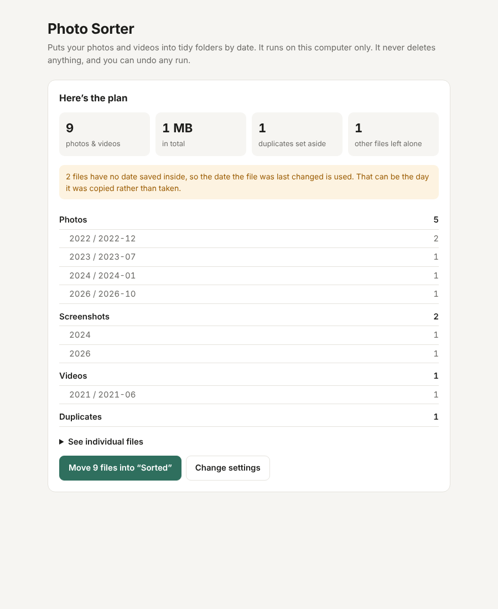

# Photo Sorter

A small personal app that puts a messy folder of photos and videos into tidy folders. It runs on your own computer, in your web browser. Nothing is uploaded anywhere.



## What it does

Point it at a folder (an external hard drive is fine). It looks at every photo and video, works out when each was taken, and shows you a plan. Nothing moves until you press the button.

```
Sorted/
  Photos/2024/2024-07/IMG_1234.HEIC
  Videos/2024/2024-07/IMG_1240.MOV
  Screenshots/2024/Screenshot 2024-07-14 at 10.11.12.png
  Duplicates/IMG_1234 copy.HEIC
  original-names_2026-10-30_18-02-11.csv
```

- **By date.** The date comes from the information the camera saves inside each photo or video. If that's missing, it comes from the file name (like `IMG_20240714_...`). As a last resort it uses the file's own date, and the plan tells you how many files that happened to.
- **Screenshots and screen recordings** get their own folder.
- **Duplicates** (byte-for-byte identical files) go into `Duplicates/`. They are set aside, not deleted.
- **Live Photos.** The short video that belongs to a photo stays next to its photo.
- **Original names are kept.** Every run also saves a spreadsheet (`original-names_….csv`) listing where each file was and where it went.
- **Safe.** It never deletes or overwrites anything. If two files have the same name, one becomes `name (1).jpg`. Files it doesn't recognize, like documents, are left where they are.
- **Undo.** Every run can be undone from the app, which puts all files back where they were.

Photos: JPG, HEIC, PNG, GIF, WebP, TIFF and camera RAW (DNG, CR2, CR3, NEF, ARW, RAF, ORF, RW2…). Videos: MOV, MP4, M4V, AVI, MKV, 3GP, MTS…

## Getting started

You need **Python 3.10 or newer**. Check by opening Terminal (Mac) or Command Prompt (Windows) and typing `python3 --version` (Mac) or `py --version` (Windows). If it's missing, install it from [python.org](https://www.python.org/downloads/). On Windows, tick **“Add python.exe to PATH”** in the installer.

1. Download this folder: on GitHub, press **Code → Download ZIP** and unzip it somewhere, such as your Documents folder.
2. Start it:
   - **Mac:** double-click **`Start Photo Sorter.command`**. If macOS says it can't be opened, right-click it, choose **Open**, then **Open** again (only needed once).
   - **Windows:** double-click **`Start Photo Sorter (Windows).bat`**. If Windows shows “Windows protected your PC”, click **More info → Run anyway**.
3. The first start takes a minute to set itself up. Then your browser opens Photo Sorter.
4. Click **Choose…** and pick your photos folder, or paste its path.
5. Click **Scan folder**, check the plan, then click **Move … files**.

Keep the small black window open while you use the app. Close it when you're done.

**Tips**
- Try it on a small folder first to see if you like the layout.
- Moving files on the same drive is instant. Moving to a *different* drive copies the data, so it takes longer.
- “Copy” mode leaves your originals alone, but needs that much free space again.

## Sorting by content (optional)

The app can also sort photos by what's in them (people, pets, food, beach, documents…) using a free AI model that **runs on your computer**. Folders then look like `Photos/Food & drinks/2024/`. You can type your own folder names. Anything that doesn't clearly fit goes into `Other`.

It's off by default because it's a big download (about 1 GB) and it is slower: expect roughly 5–20 photos a second, depending on your computer. To turn it on:

- **Mac:** in Terminal, `cd` into this folder, then run
  `.venv/bin/pip install -r requirements-ai.txt`
- **Windows:** in Command Prompt, `cd` into this folder, then run
  `.venv\Scripts\pip install -r requirements-ai.txt`

Restart the app, and the **“Also sort photos by what’s in them”** box becomes available. The first scan downloads the AI model (about 600 MB) once. Videos are still sorted by date only.

## Command line (optional)

```
python -m photosorter                      # open the app in the browser
python -m photosorter scan "D:\Photos"     # just show the plan
python -m photosorter sort "D:\Photos"     # show the plan, then sort after you type y
python -m photosorter undo "D:\Photos\Sorted"
```

Add `--copy` to copy instead of move, `--dest "E:\Sorted"` to put the result somewhere else, and `--by-content` for AI sorting.

## For developers

```
python3 -m venv .venv && .venv/bin/pip install -r requirements.txt pytest
.venv/bin/python -m pytest
```

- `photosorter/media.py` reads file types, dates and screenshot hints. It reads video dates straight from the file, so ffmpeg isn't needed.
- `photosorter/planner.py` builds the plan, including duplicates and Live Photo pairs.
- `photosorter/mover.py` moves the files, writes the run log (`Sorted/.photo-sorter/runs/*.jsonl`), and undoes runs.
- `photosorter/ai.py` is the optional OpenCLIP classifier.
- `photosorter/server.py` and `static/index.html` are the browser app. The server only listens on `127.0.0.1`.
